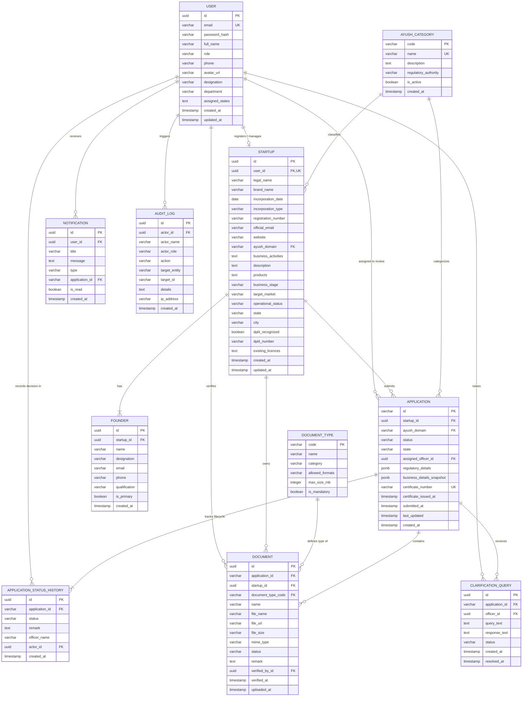

# Entity-Relationship (ER) Diagram Specification

## 1. Overview

This document presents the complete **Entity-Relationship (ER) Diagram** for the **AYUSH Startup Registration Portal**. The data model is derived from the functional requirements and the actual frontend implementation (`frontend/src/pages/`, `frontend/src/context/`, and `frontend/src/data/mockData.js`).

The database is designed to run on **PostgreSQL**, adhering to Third Normal Form (3NF), ensuring referential integrity, eliminating data anomalies, and supporting multi-role application tracking, document verification, clarification cycles, and audit logging.

---

## 2. Complete Mermaid ER Diagram

---

## 3. Entity Relationships and Cardinalities

### 3.1 Core Authentication & Profile Relationships
1. **`USER` $\longleftrightarrow$ `STARTUP` (1 : 0..1)**
   - *Cardinality*: One-to-Optional-One.
   - *Description*: A user with the `startup` role creates and manages exactly one `STARTUP` profile. Users with `officer` or `admin` roles do not possess a startup profile.
   - *Foreign Key*: `STARTUP.user_id` $\rightarrow$ `USER.id` (`UNIQUE`, `NOT NULL`, `ON DELETE CASCADE`).

2. **`STARTUP` $\longleftrightarrow$ `FOUNDER` (1 : 1..N)**
   - *Cardinality*: One-to-Many (Mandatory at least one).
   - *Description*: Every startup must register at least one primary founder and can add up to three co-founders (as captured in Step 1 of the application form).
   - *Foreign Key*: `FOUNDER.startup_id` $\rightarrow$ `STARTUP.id` (`NOT NULL`, `ON DELETE CASCADE`).

### 3.2 Application Submission & Categorization Relationships
3. **`STARTUP` $\longleftrightarrow$ `APPLICATION` (1 : 0..N)**
   - *Cardinality*: One-to-Many.
   - *Description*: A registered startup can file one or more applications over time (e.g., initial recognition, subsequent renewals, or registrations in multiple AYUSH streams).
   - *Foreign Key*: `APPLICATION.startup_id` $\rightarrow$ `STARTUP.id` (`NOT NULL`, `ON DELETE CASCADE`).

4. **`AYUSH_CATEGORY` $\longleftrightarrow$ `STARTUP` & `APPLICATION` (1 : 0..N)**
   - *Cardinality*: One-to-Many.
   - *Description*: Master reference table defining the 5 statutory streams (Ayurveda, Yoga & Naturopathy, Unani, Siddha, Homoeopathy). Both the startup profile and specific applications reference this table.
   - *Foreign Key*: `STARTUP.ayush_domain` and `APPLICATION.ayush_domain` $\rightarrow$ `AYUSH_CATEGORY.code`.

5. **`USER (Officer)` $\longleftrightarrow$ `APPLICATION` (0..1 : 0..N)**
   - *Cardinality*: Optional One-to-Many.
   - *Description*: An application in `Draft` or `Submitted` status initially has no assigned officer (`assigned_officer_id IS NULL`). When a reviewer opens or claims it (`Under Review`), the officer's `USER.id` is linked.
   - *Foreign Key*: `APPLICATION.assigned_officer_id` $\rightarrow$ `USER.id` (`NULLABLE`, `ON DELETE SET NULL`).

### 3.3 Document Management Relationships
6. **`APPLICATION` $\longleftrightarrow$ `DOCUMENT` (1 : 0..N)**
   - *Cardinality*: One-to-Many.
   - *Description*: An application contains mandatory and optional compliance documents.
   - *Foreign Key*: `DOCUMENT.application_id` $\rightarrow$ `APPLICATION.id` (`NULLABLE` for startup-level repository files, `ON DELETE CASCADE`).

7. **`STARTUP` $\longleftrightarrow$ `DOCUMENT` (1 : 0..N)**
   - *Cardinality*: One-to-Many.
   - *Description*: Enables the startup dashboard's document repository view (`/dashboard/documents`), preserving all uploaded documents across submissions.
   - *Foreign Key*: `DOCUMENT.startup_id` $\rightarrow$ `STARTUP.id` (`NOT NULL`, `ON DELETE CASCADE`).

8. **`DOCUMENT_TYPE` $\longleftrightarrow$ `DOCUMENT` (1 : 0..N)**
   - *Cardinality*: One-to-Many.
   - *Description*: Validates the category, maximum allowable size, and format of uploaded documents (incorporation, drug manufacturing license, lab report, etc.).
   - *Foreign Key*: `DOCUMENT.document_type_code` $\rightarrow$ `DOCUMENT_TYPE.code`.

9. **`USER (Officer)` $\longleftrightarrow$ `DOCUMENT` (0..1 : 0..N)**
   - *Cardinality*: Optional One-to-Many.
   - *Description*: When an officer marks a document as `Verified` or `Rejected`, the officer's ID is recorded for verification accountability.
   - *Foreign Key*: `DOCUMENT.verified_by_id` $\rightarrow$ `USER.id` (`NULLABLE`, `ON DELETE SET NULL`).

### 3.4 Status Tracking, Queries & Auditability
10. **`APPLICATION` $\longleftrightarrow$ `APPLICATION_STATUS_HISTORY` (1 : 1..N)**
    - *Cardinality*: One-to-Many (Append-only).
    - *Description*: Captures every status transition (`Draft` $\rightarrow$ `Submitted` $\rightarrow$ `Under Review` $\rightarrow$ `Clarification Required` $\rightarrow$ `Resubmitted` $\rightarrow$ `Approved` / `Rejected`) with officer remarks and timestamps. Powers the frontend `<Timeline>` component.
    - *Foreign Key*: `APPLICATION_STATUS_HISTORY.application_id` $\rightarrow$ `APPLICATION.id` (`NOT NULL`, `ON DELETE CASCADE`).

11. **`APPLICATION` $\longleftrightarrow$ `CLARIFICATION_QUERY` (1 : 0..N)**
    - *Cardinality*: One-to-Many.
    - *Description*: When an officer flags missing documents or claims, a query record is created. The applicant responds directly within this record during resubmission.
    - *Foreign Key*: `CLARIFICATION_QUERY.application_id` $\rightarrow$ `APPLICATION.id` (`NOT NULL`, `ON DELETE CASCADE`).

12. **`USER` $\longleftrightarrow$ `NOTIFICATION` (1 : 0..N)**
    - *Cardinality*: One-to-Many.
    - *Description*: In-app notifications sent to specific users regarding status changes, assigned applications, or clarification requests.
    - *Foreign Key*: `NOTIFICATION.user_id` $\rightarrow$ `USER.id` (`NOT NULL`, `ON DELETE CASCADE`).

13. **`USER` $\longleftrightarrow$ `AUDIT_LOG` (0..1 : 0..N)**
    - *Cardinality*: Optional One-to-Many.
    - *Description*: Records critical security, role, and administrative operations. If a user is deactivated or removed, the audit log preserves the historic actor name and ID (`ON DELETE SET NULL`).
    - *Foreign Key*: `AUDIT_LOG.actor_id` $\rightarrow$ `USER.id` (`NULLABLE`, `ON DELETE SET NULL`).

---

## 4. Key Diagram Observations & Design Rationale

1. **Separation of Startup Profile from Specific Applications**:
   - Company details (CIN, brand, incorporation date) are stored in `STARTUP`, whereas dynamic review data (submission date, status, assigned reviewer, certificate) are stored in `APPLICATION`. This allows startups to submit multiple applications over time without duplicate company profiles.
2. **Immutable Status History vs. Current Status**:
   - `APPLICATION.status` provides $O(1)$ fast lookups for reviewer queues and filtering.
   - `APPLICATION_STATUS_HISTORY` preserves an append-only timeline of every transition, matching the frontend's timeline view.
3. **Structured Query Management**:
   - Rather than burying reviewer queries in generic remarks, `CLARIFICATION_QUERY` explicitly tracks the query text, applicant response text, and resolution status across review iterations.

