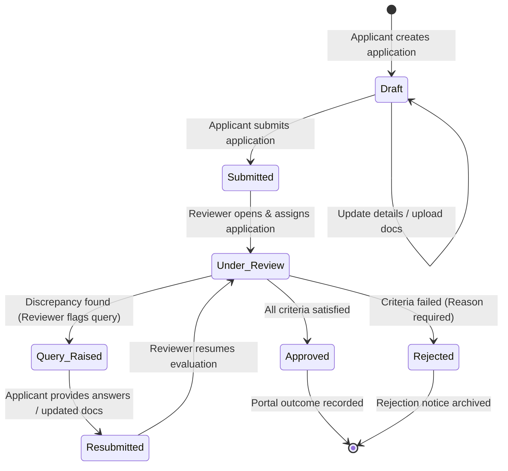
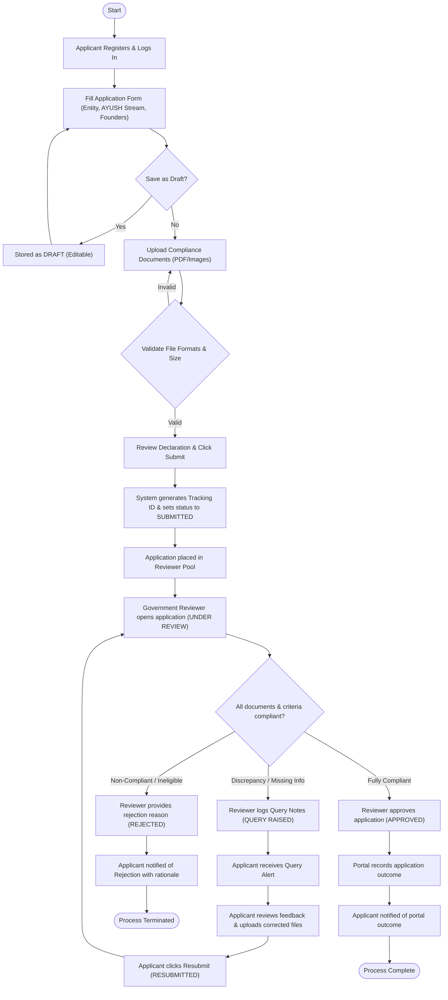

# Application Workflow and Lifecycle Specification

This is the target application workflow. The backend supports startup draft creation, listing, reading, updating, submission, and status history, including server-generated tracking IDs. The React application screens still simulate these flows with mock data; officer review, queries, document handling, and notifications are not yet implemented end to end. Portal outcomes must not be described as statutory AYUSH licences or regulatory approvals. See [implementation-status.md](./implementation-status.md).

## 1. Introduction

The target **AYUSH Startup Registration Portal** follows a structured, transparent, and asynchronous lifecycle. The workflow transitions from initial onboarding to a portal-recorded review outcome or rejection, with an audit trail at each stage.

---

## 2. End-to-End Workflow Stages

### Stage 1: Account Creation & Authentication
1. **Registration**: The founder or company representative visits the portal and creates an account using email, secure password, mobile number, and full name.
2. **Email Verification**: A verification link or one-time passcode (OTP) confirms email ownership.
3. **Session Establishment**: The target API issues a JWT with the canonical role `STARTUP`.

### Stage 2: Startup Profile Initiation & Draft Creation
1. **Initiate Application**: The applicant starts a portal application.
2. **Draft State**: The application is initialized with status `DRAFT` and assigned a temporary identifier.
3. **Multi-Step Form Completion**:
   - **Step 2A (Entity Information)**: Company name, incorporation date, entity type (Private Limited, LLP, Registered Partnership), PAN, GSTIN, registered address, and state.
   - **Step 2B (AYUSH Classification)**: Selection of primary discipline (Ayurveda, Yoga & Naturopathy, Unani, Siddha, Homoeopathy) and business domain (Formulations, Wellness/Services, Medical Devices, Agri-tech/Medicinal Plants, Digital Health).
   - **Step 2C (Innovation & Products)**: Description of innovative elements, target healthcare challenge, stage of development (Ideation, Prototype, Clinical Testing, Market-Ready), and IPR/Patent details.
   - **Step 2D (Directors & Key Personnel)**: Contact details, educational backgrounds, and national identification of key personnel.
4. **Autosave / Manual Save**: The applicant can save progress as a draft and resume later.

### Stage 3: Document Upload & Verification Preparation
1. **Mandatory Document Checklist**:
   - Certificate of Incorporation / Registration Proof.
   - PAN & GST registration documents.
   - Manufacturing License / Formulations Clearance (if applicable for drug/herbal products).
   - Quality control certificates, Lab Test reports, or clinical trial clearance (if applicable).
   - Pitch deck / Executive summary / Product brochure.
2. **File Restrictions**: Only `.pdf`, `.jpg`, `.jpeg`, and `.png` files under 5 MB are accepted.
3. **Secure Storage**: Files are uploaded to secure storage, and their file paths/URLs and checksums are linked to the application record.

### Stage 4: Form Review & Formal Submission
1. **Review Summary**: The applicant reviews an aggregated preview of the complete application and attached documents.
2. **Legal Undertaking & Declaration**: The applicant confirms that all provided information is accurate and compliant with Ministry of AYUSH norms.
3. **Submission**: The application state transitions from `DRAFT` to `SUBMITTED`.
4. **Tracking ID Generation**: The backend assigns a unique tracking number in the contract format `APP-YYYY-NNN` and dispatches a confirmation notification. This server-generated identifier is not yet implemented; the frontend demo must not fabricate it. The application is then locked against direct edits.

### Stage 5: Reviewer Queue & Evaluation
1. **Reviewer Inbox**: The application appears in the Government Reviewer's active review pool.
2. **Claiming / Assignment**: A reviewer opens the application, transitioning the status from `SUBMITTED` to `UNDER_REVIEW`.
3. **Verification Process**:
   - Scrutinize business and innovation claims against AYUSH criteria.
   - Validate attached regulatory, incorporation, and lab testing documents.
   - Review the portal application criteria and inspect relevant supporting documents. A portal decision does not grant or replace approvals from competent regulatory authorities.

### Stage 6: Clarification & Query Cycle (Conditional Branch)
If discrepancies, unreadable files, or missing information are discovered:
1. **Raise Query**: The reviewer logs specific remarks, notes the missing or inconsistent elements, and flags the application. Status transitions to `QUERY_RAISED`.
2. **Applicant Notification**: The applicant receives an urgent alert detailing the reviewer's query.
3. **Applicant Response**: The applicant logs in, inspects reviewer notes, uploads requested replacement/supplementary documents, and submits an explanation.
4. **Resubmission**: The status transitions from `QUERY_RAISED` to `RESUBMITTED`, returning the application to the reviewer's queue for re-evaluation.

### Stage 7: Final Adjudication
1. **Approval Path**:
   - The reviewer verifies full compliance and approves the application.
   - The status updates to `APPROVED`.
   - The portal records the application outcome as `APPROVED` and notifies the applicant.
   - If a portal acknowledgement is later included in scope, it must be labeled as an internal administrative record and must not imply statutory licensing, regulatory approval, or legal certification.
2. **Rejection Path**:
   - If the application fails fundamental regulatory criteria or fraudulent documents are detected, the reviewer rejects the submission.
   - Status updates to `REJECTED`.
   - The reviewer must provide mandatory written justification explaining the decision.

### Stage 8: Real-Time Status Tracking & Notifications
- Throughout the process, the applicant tracks progress via a dynamic status timeline.
- Every state transition generates:
  - An in-app status update.
  - An immutable entry in the `ApplicationStatusHistory` audit table.

---

## 3. Application Lifecycle State Diagram

The following state machine details all possible application statuses and valid transitions:

---

## 4. End-to-End Workflow Flowchart

The flowchart below visualizes interactions between the Applicant, Reviewer, and the Portal System across all stages:

---

## 5. Audit Trail & State Transition Invariants

To guarantee transparency and non-repudiation:
1. **Immutability of Historical States**: No historical state record may be deleted or modified. Every transition is an `INSERT` into an audit log.
2. **Actor Association**: Every state change must store the `user_id` of the actor who triggered it.
3. **Transition Rules**:
   - An application cannot skip from `Draft` directly to `Approved`.
   - An application cannot transition from `Query Raised` directly to `Approved` without passing through `Resubmitted` and `Under Review`.
   - Once marked `Approved` or `Rejected`, the application state is final.

