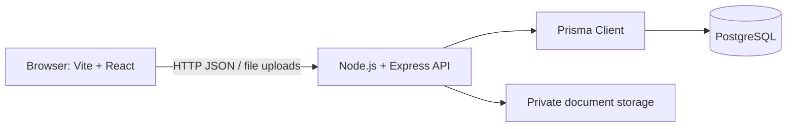

# System Architecture

## 1. Architectural Overview

The **AYUSH Startup Registration Portal** follows a modern, modular **Three-Tier Architecture** consisting of the **Presentation Layer (React 19 / Vite Frontend)**, **Application / Business Logic Layer (Node.js / Express REST API)**, and **Data & Persistence Layer (PostgreSQL Database & Secure Object Storage)**. 

The design emphasizes separation of concerns, strict type safety, end-to-end security, and relational data integrity aligned with Advanced Software Development and DBMS engineering principles.

---

## 2. System Architecture Diagram

The diagram below illustrates the architectural layers, internal components, and communication pathways across the entire portal:

## Responsibilities

### Frontend

### 3.1 Presentation Layer (Frontend)
- **Framework**: React 19, Vite 6, Tailwind CSS v4, and React Router v7.
- **Responsibilities**:
  - Rendering responsive, accessible user interfaces following government visual standards.
  - Multi-step client-side form wizards with validation via React Hook Form and Zod schemas.
  - Interactive status timelines, document preview drawers, and Recharts analytics dashboards.
  - Role-based routing (`<ProtectedRoute>`) isolating Startup, Officer, and Admin paths.
- **Sub-systems**:
  - **Public Portal**: Informational landing page, AYUSH guidelines, eligibility checklists, and FAQs.
  - **Applicant Dashboard**: Profile management, 7-step application filing, document upload, query responses, and certificate download.
  - **Reviewer Desk**: Application queue, document inspection pane, query generation modal, and adjudication console.
  - **Admin Console**: Platform analytics, user/officer provisioning, master category rules, and audit log exports.

### 3.2 Business Logic & Application Layer (Backend)
- **Framework**: Node.js & Express REST API server running on port 5000.
- **Responsibilities & Communication**:
  - Exposes RESTful JSON endpoints grouped into domain routers (`/api/auth`, `/api/applications`, `/api/documents`, `/api/officers`, `/api/admin`, `/api/notifications`).
  - **Authentication & RBAC Middleware**: Verifies signed JSON Web Tokens (`Authorization: Bearer <token>`) and enforces role boundaries (`startup`, `officer`, `admin`) before controller execution.
  - **Validation Layer**: Validates incoming request payloads with Zod before database processing.
  - **Application Lifecycle Engine**: Enforces valid status transitions (`Draft` $\rightarrow$ `Submitted` $\rightarrow$ `Under Review` $\rightarrow$ `Clarification Required` $\rightarrow$ `Resubmitted` $\rightarrow$ `Approved` / `Rejected`).
  - **Document Service**: Validates file MIME types and size constraints ($\le 5\text{MB}$), generates secure signed storage links, and manages verification updates.
  - **Clarification & Query Service**: Manages bidirectional query notes between reviewers and applicants.
  - **Audit Logging Service**: Records every status transition, review action, and administrative operation.

### 3.3 Data & Persistence Layer (Database & Storage)
- **Relational Database**: PostgreSQL (Relational DBMS)
  - Stores all structured business entities (`users`, `startups`, `founders`, `ayush_categories`, `document_types`, `applications`, `documents`, `application_status_history`, `clarification_queries`, `notifications`, `audit_logs`).
  - Enforces relational constraints (foreign keys with `ON DELETE CASCADE` or `ON DELETE SET NULL`, non-null checks, unique indexes).
  - Handles concurrent requests using row-level locking, connection pooling, and strict ACID transactions.
- **Inter-Tier Communication**:
  - **Frontend $\longleftrightarrow$ Backend**: Asynchronous HTTP/HTTPS REST requests using Axios (`frontend/src/services/api.js`), exchanging JSON payloads. Form uploads use `multipart/form-data`.
  - **Backend $\longleftrightarrow$ Database**: Connection-pooled SQL connections via Prisma ORM client with parameterized queries preventing SQL injection.
- **Document / Object Storage**:
  - Encrypted file repository storing uploaded certificates, test reports, and pitch decks.
  - Avoids storing binary BLOBs inside the relational database, ensuring database performance and backup efficiency.

### Database and files

PostgreSQL stores structured records. Prisma defines the data model, provides database access from JavaScript, and manages migrations. Uploaded files belong in private file storage; PostgreSQL stores their metadata and storage identifiers.

## Request flow

1. The browser sends an API request to Express.
2. Express authenticates the request and checks permissions.
3. The application logic validates the request and applies workflow rules.
4. Prisma reads or updates PostgreSQL, using a transaction for related critical updates.
5. Express returns a JSON response to the browser.

The portal may track application outcomes or portal recognition. It must not claim to issue statutory licenses or regulatory approvals that belong to an external authority.
