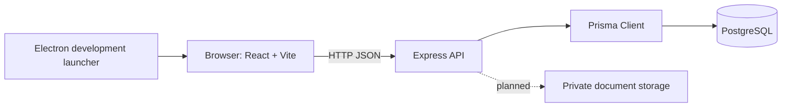

# System Architecture

## Target architecture

The target system has three main layers: a React website (also opened by Electron), a Node.js/Express API, and PostgreSQL accessed through Prisma. Private file storage is a planned capability.

## Current implementation

- **Website:** Public and startup pages for resources consume the backend resources API. Real login, registration, logout, and session restoration use the backend auth API; demo role sign-in remains local. Live startup accounts load their profile and application list/detail from the API and create, edit, and submit drafts through it. Demo applicant workflows remain local; documents, clarification responses, notifications, and officer/admin workflows are not fully connected.
- **Electron:** Opens the same website in a native window and reuses its routes and behavior. It is a development launcher, not a packaged desktop release.
- **API:** Express routes currently cover health, bcrypt/JWT auth, startup profile read/create/update, startup application draft/read/update/submit/status history, and static public resources.
- **Persistence:** The auth/startup/application endpoints use the shared Prisma client and PostgreSQL. Resource content is currently static in the resources route rather than stored in the database.
- **File storage:** There is no server-side upload/download implementation yet.

The backend routes exist independently of the React contexts. Except for resources, the website is not yet using those routes for its main workflow. See [implementation-status.md](./implementation-status.md) for checks and remaining work.

## Layer responsibilities

### Frontend and desktop

React renders the public and role-specific screens and sends HTTP requests through the Axios service where integrations exist. Client-side route guards support navigation but are not an authorization boundary. Electron loads the website; it does not implement a separate backend or database layer.

### API

Express handles HTTP requests, validation, authentication, authorization, and workflow rules. Implemented route groups are `/api/auth`, `/api/startups`, `/api/applications`, and `/api/resources`. Document upload, officer, query, notification, admin, and category route groups are not complete.

### Database and file storage

PostgreSQL is modeled by `backend/prisma/schema.prisma`; versioned Prisma migrations are the reproducible schema setup. The SQL scripts under `database/` are standalone DBMS materials. Uploaded documents are intended for private storage with metadata in PostgreSQL, but that feature is not implemented.

## Domain boundary

The portal records application workflow outcomes. It does not issue statutory AYUSH licences, official regulatory approvals, or legal certifications.
