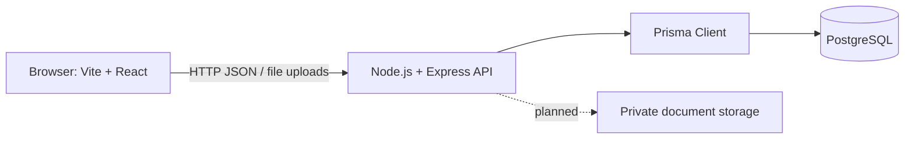

# System Architecture

## 1. Architectural Overview

The **target AYUSH Startup Registration Portal** uses a three-tier architecture: a React 19 / Vite frontend, a Node.js / Express API, and PostgreSQL persistence. Private document storage is a planned backend capability.

The design emphasizes separation of concerns, server-side authorization, and relational data integrity aligned with Advanced Software Development and DBMS engineering principles.

## Current implementation

- The React app contains public, startup, officer, and admin screens and client-side route guards. Screens and contexts still use mock data and browser storage.
- The Axios service is prepared with the documented base URL and route wrappers, but no page or context currently consumes those wrappers.
- The CommonJS Express scaffold listens on port `3005` and exposes only `GET /api/health`. Business routes and authentication middleware are not present.
- Prisma 7 configuration exists, but `backend/prisma/schema.prisma` has no models. Standalone SQL scripts exist under `database/`; no live database connection was verified.
- Real file storage, live review workflows, notifications, and admin data are not implemented.

The diagram and layer responsibilities below describe the intended architecture, not a connected end-to-end system. See [implementation-status.md](./implementation-status.md) for the verified state and integration gaps.

---

## 2. System Architecture Diagram

The diagram below illustrates the planned architectural layers and communication pathways:

## Responsibilities

### Frontend

### 3.1 Presentation Layer (Frontend)
- **Framework**: React 19, Vite 6, Tailwind CSS v4, and React Router v7.
- **Responsibilities**:
  - Rendering responsive, accessible user interfaces following government visual standards.
  - A seven-step client-side application form. It currently uses React state and local demo data; React Hook Form and Zod are dependencies but are not used by this wizard.
  - Interactive status timelines, document preview drawers, and Recharts analytics dashboards.
  - Client-side role-based routing (`<ProtectedRoute>`) for demo navigation. These route guards do not replace backend authorization.
- **Sub-systems**:
  - **Public Portal**: Informational landing page, AYUSH guidelines, eligibility checklists, and FAQs.
  - **Applicant Dashboard**: Profile, application, document, guidance, and notification prototype screens.
  - **Reviewer Desk**: Queue, document review, clarification, and decision prototype screens.
  - **Admin Console**: Analytics, user/officer, category, resource, and audit-log prototype screens.

### 3.2 Business Logic & Application Layer (Backend)
- **Framework**: Node.js & Express REST API scaffold running on port `3005`.
- **Responsibilities & Communication**:
  - The target API exposes routers under `/api/auth`, `/api/startups`, `/api/applications`, `/api/documents`, `/api/queries`, `/api/officer`, `/api/notifications`, `/api/admin`, `/api/resources`, and `/api/categories`.
  - **Authentication, authorization, validation, workflow rules, document handling, query handling, and audit logging are planned; none are implemented in the current scaffold.**

### 3.3 Data & Persistence Layer (Database & Storage)
- **Relational Database**: PostgreSQL (Relational DBMS)
  - The target schema stores the entities described by the database design and API contract.
  - Enforces relational constraints (foreign keys with `ON DELETE CASCADE` or `ON DELETE SET NULL`, non-null checks, unique indexes).
  - Transactions for critical workflow changes are part of the target design, not current backend behavior.
- **Inter-Tier Communication**:
  - **Frontend $\longleftrightarrow$ Backend**: The prepared Axios client is intended to exchange JSON and `multipart/form-data`; screens are not connected to it yet.
  - **Backend $\longleftrightarrow$ Database**: Prisma is the target access layer. No Prisma models or live connection are currently in place.
- **Document / Object Storage (planned)**:
  - Private storage for uploaded startup and compliance documents, with metadata in PostgreSQL.
  - No server-side upload or download storage is implemented.

### Database and files

In the target system, PostgreSQL stores structured records and Prisma defines the data model and access layer. The current SQL scripts are separate from the empty Prisma model file. Uploaded files are intended for private storage, with metadata in PostgreSQL.

## Request flow

1. In the target flow, the browser sends an API request to Express.
2. Express authenticates the request and checks permissions.
3. Application logic validates input and applies workflow rules.
4. Prisma reads or updates PostgreSQL, using transactions for related critical changes.
5. Express returns a JSON response to the browser.

The portal may track application outcomes or portal recognition. It must not claim to issue statutory licenses or regulatory approvals that belong to an external authority.
