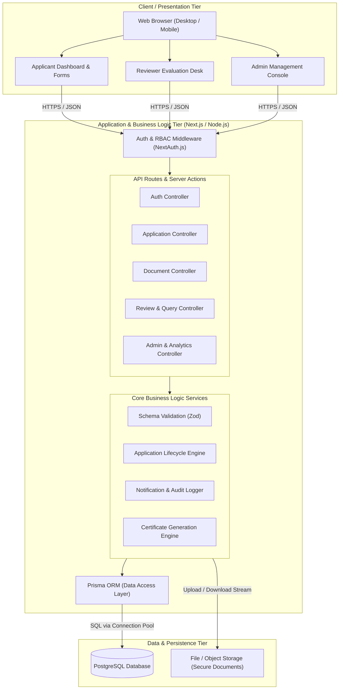
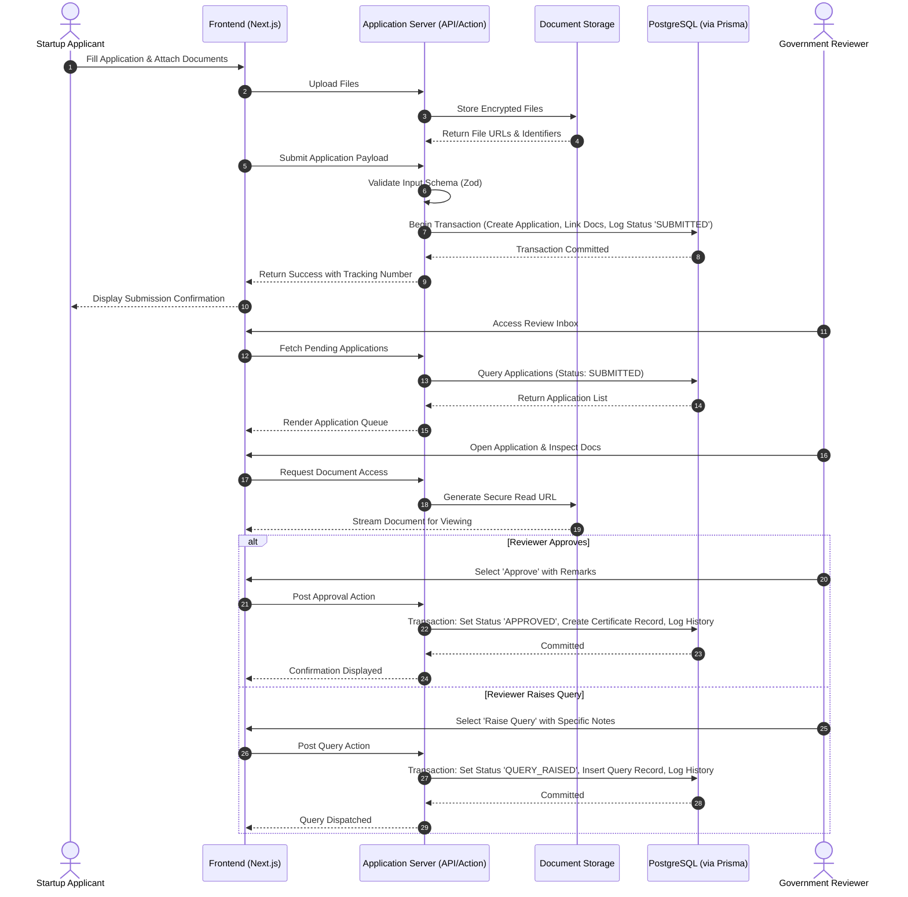

# High-Level System Architecture Specification

## 1. Architectural Overview

The **AYUSH Startup Registration Portal** follows a modern, modular **Three-Tier Architecture** consisting of the **Presentation Layer**, **Application / Business Logic Layer**, and **Data & Persistence Layer**. 

The design emphasizes separation of concerns, strict type safety, end-to-end security, and relational data integrity aligned with Advanced Software Development and DBMS engineering principles.

---

## 2. System Architecture Diagram

The diagram below illustrates the architectural layers, internal components, and communication pathways across the entire portal:

---

## 3. Tier-by-Tier Architectural Breakdown

### 3.1 Presentation Layer (Frontend)
- **Framework**: Next.js (React 19/18) utilizing App Router architecture.
- **Responsibilities**:
  - Rendering responsive, accessible user interfaces.
  - Multi-step client-side form wizards with client validation via React Hook Form and Zod.
  - Asynchronous status updates and interactive timeline visualizers.
  - Secure document preview and file upload progress management.
- **Sub-systems**:
  - **Public Portal**: Information pages, AYUSH guidelines, eligibility checklists, and FAQs.
  - **Applicant Dashboard**: Profile management, application filing, query responses, and certificate download.
  - **Reviewer Desk**: Application inbox, document verification pane, query creation panel, and decision console.
  - **Admin Console**: User management, reviewer account creation, audit trails, and aggregate analytics.

### 3.2 Business Logic & Application Layer (Backend)
- **Framework**: Next.js Server Components, Server Actions, and Route Handlers.
- **Key Modules**:
  - **Authentication & RBAC Middleware**: Intercepts requests, validates JWT/session cookies, and rejects unauthorized role access before processing.
  - **Application Lifecycle Engine**: Enforces valid state transitions (`Draft` $\rightarrow$ `Submitted` $\rightarrow$ `Under Review` $\rightarrow$ `Query Raised` / `Approved` / `Rejected`).
  - **Document Service**: Manages upload stream validation (MIME-type detection, size boundaries) and generates secure signed URLs for document access.
  - **Query & Communication Module**: Manages back-and-forth remarks between reviewers and applicants.
  - **Certificate Engine**: Generates unique AYUSH Startup Registration IDs and verification tokens upon approval.
  - **Audit Logging Service**: Records every status transition, reviewer action, and administrative operation.

### 3.3 Data & Persistence Layer (Database & Storage)
- **Relational Database**: PostgreSQL
  - Stores all structured business entities (Users, Profiles, Applications, Queries, Review Notes, Status History, Certificates).
  - Enforces relational constraints (foreign keys, non-null constraints, unique indexes).
  - Handles concurrent requests using row-level locking and ACID transactions.
- **ORM / Query Abstraction**: Prisma ORM
  - Provides a single source of truth schema (`schema.prisma`).
  - Generates strongly-typed TypeScript queries, preventing SQL injection vulnerabilities.
  - Tracks schema changes via versioned migration scripts.
- **Document / Object Storage**:
  - Encrypted file repository storing uploaded certificates, test reports, and pitch decks.
  - Avoids storing binary BLOBs inside the relational database, ensuring database performance and backup efficiency.

---

## 4. End-to-End Data Flow (Registration to Review)

The sequence diagram below illustrates the complete data flow during an application submission and subsequent reviewer evaluation:

---

## 5. Security Architecture & Threat Mitigation

| Security Concern | Threat Vector | Mitigation Strategy in AYUSH Portal |
| :--- | :--- | :--- |
| **Authentication** | Credential stuffing, brute force | Passwords hashed using bcrypt ($\ge 10$ salt rounds); rate-limiting on login routes. |
| **Authorization** | Horizontal & vertical privilege escalation | Server-side role checks and tenant isolation; applicants can only read/write their own records. |
| **SQL Injection** | Malicious SQL inputs | Fully parameterized queries generated by Prisma ORM; direct string concatenation forbidden. |
| **Cross-Site Scripting (XSS)** | Malicious scripts in input fields | Auto-escaping in React; server-side sanitization of text areas with Zod schemas. |
| **Unauthorized File Access** | Direct access to confidential patents/formulas | Files stored in private buckets accessible only through time-limited signed URLs generated for authenticated sessions. |
| **Data Integrity** | Partial writes or corrupt application states | All state transitions, status updates, and certificate issuances wrapped in PostgreSQL ACID transactions. |

---

## 6. DBMS Alignment & Scalability Strategy

- **Relational Normalization**: The data schema is designed up to 3rd Normal Form (3NF) to minimize data redundancy while maintaining query efficiency.
- **Indexing Strategy**: Indexes placed on frequently queried fields:
  - `applications(status)` - for rapid filtering of reviewer queues.
  - `applications(user_id)` - for instant loading of applicant dashboard records.
  - `applications(ayush_stream)` - for stream-based official filtering and analytics.
  - `applications(tracking_number)` - unique B-tree index for tracking lookups.
- **Auditability**: Dedicated `status_history` table tracking all changes with timestamps, actor IDs, previous states, and subsequent states.

