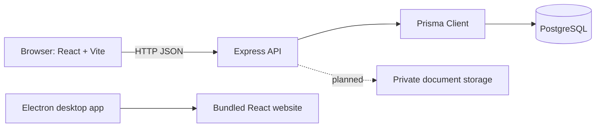

# System Architecture

## Target architecture

The target system has three main layers: a React website (also opened by Electron), a Node.js/Express API, and PostgreSQL accessed through Prisma. Private file storage is a planned capability.

## Current implementation

- **Website:** Public and startup pages for resources consume the backend resources API. Real login, registration, logout, and session restoration use the backend auth API; demo role sign-in remains local. Live startup accounts load their profile and application list/detail from the API and create, edit, and submit drafts through it. Startup detail screens load clarification requests, send responses, and resubmit applications. API officers load their assigned review queue; admins load the non-draft queue, assign officers, and can open review screens. Review start, approve/reject, clarification raise/resolution, and notification list/read actions use the API. Demo workflows remain local; document actions are not connected.
- **Electron:** Opens the same website in a native window and reuses its routes and behavior. In development it starts Vite; in a packaged build it serves bundled React assets on loopback port 5173. It does not bundle the Express API or PostgreSQL database.
- **API:** Express routes cover health, bcrypt/JWT auth, startup profile read/create/update, startup application draft/read/update/submit/status history, officer/admin review queues, officer listing for assignment, application assignment, review start and decision, clarification query create/list/respond/resolve, authenticated notification list/read actions, and static public resources.
- **Persistence:** The auth/startup/application endpoints use the shared Prisma client and PostgreSQL. Resource content is currently static in the resources route rather than stored in the database.
- **File storage:** There is no server-side upload/download implementation yet.

The backend routes exist independently of the React contexts. The connected website uses the auth, startup, application, resources, category, officer/admin review, clarification, notification, admin analytics, user-list, and audit-log routes described above. Document upload/verification and account activation remain incomplete. See [implementation-status.md](./implementation-status.md) for checks and remaining work.

## Layer responsibilities

### Frontend and desktop

React renders the public and role-specific screens and sends HTTP requests through the Axios service where integrations exist. Client-side route guards support navigation but are not an authorization boundary. Electron loads the same website; it does not implement a separate backend or database layer. Its production bundle and build instructions are maintained in `desk_App/`.

### API

Express handles HTTP requests, validation, authentication, authorization, and workflow rules. Implemented endpoint prefixes include `/api/auth`, `/api/startups`, `/api/applications`, `/api/officer`, `/api/queries`, `/api/notifications`, `/api/resources`, `/api/categories`, and read-only `/api/admin` endpoints. Assignment, review-start, decision, and query actions are mounted under their documented `/api` paths. Document upload/verification and account activation are not complete.

### Database and file storage

PostgreSQL is modeled by `backend/prisma/schema.prisma`; versioned Prisma migrations are the reproducible schema setup. The SQL scripts under `database/` are standalone DBMS materials. Uploaded documents are intended for private storage with metadata in PostgreSQL, but that feature is not implemented.

## Domain boundary

The portal records application workflow outcomes. It does not issue statutory AYUSH licences, official regulatory approvals, or legal certifications.
