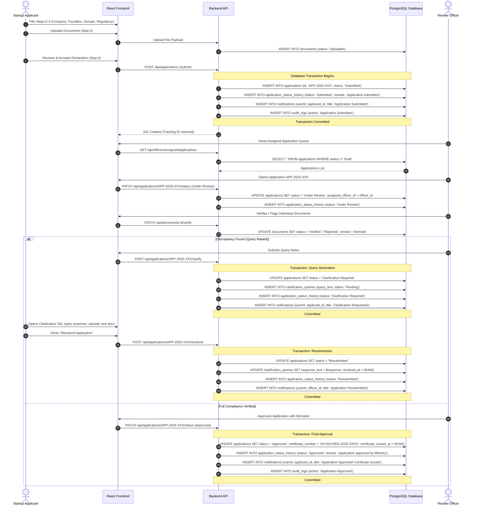
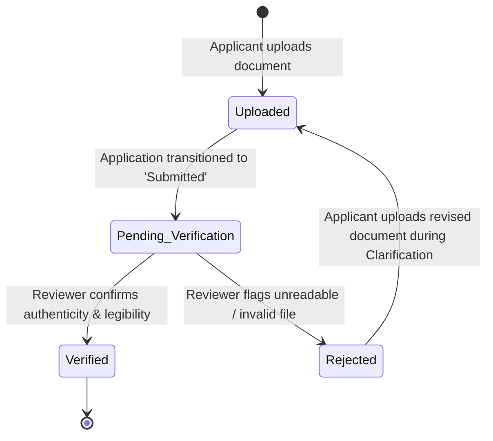

# Database Workflow and Data Flow Mapping

## 1. Overview

This document defines how frontend actions, component state transitions, and user interactions map to database queries, transactions, and state mutations within the **AYUSH Startup Registration Portal**.

---

## 2. Frontend Feature to Database Entity Mapping

| Frontend View & Component | Relevant File | Read Operations (SELECT) | Write Operations (INSERT / UPDATE) |
| :--- | :--- | :--- | :--- |
| **Authentication & Profile** | `AuthContext.jsx` `LoginPage.jsx` `StartupProfile.jsx` | `users` (by email / id) `startups` (by `user_id`) `founders` (by `startup_id`) | **INSERT**: new user into `users`, new startup into `startups` **UPDATE**: startup contact details |
| **Application Wizard (7 Steps)** | `NewApplication.jsx` `ApplicationContext.jsx` | `ayush_categories` (master domains) `document_types` (upload checklist) | **INSERT**: `applications` (`status = 'Draft'` or `'Submitted'`) **INSERT**: `documents` records **INSERT**: `application_status_history` (`'Application created'`) |
| **Applicant Dashboard & Tracking** | `StartupDashboard.jsx` `ApplicationsList.jsx` `ApplicationDetail.jsx` | `applications` (by `startup_id`) `documents` (by `application_id`) `application_status_history` (timeline) `clarification_queries` (pending queries) | **UPDATE**: `applications` (`status = 'Resubmitted'`, `last_updated = NOW()`) **INSERT**: `application_status_history` **UPDATE**: `clarification_queries` (`response_text`) |
| **Document Management** | `DocumentManagement.jsx` `FileUpload.jsx` | `documents` (by `startup_id` or `application_id`) `document_types` | **INSERT**: new `documents` **DELETE**: unverified draft documents |
| **Officer Review Desk** | `OfficerDashboard.jsx` `OfficerApplications.jsx` `OfficerApplicationReview.jsx` | `applications` (`status != 'Draft'`) `startups` & `founders` `documents` `application_status_history` | **UPDATE**: `applications.status` (`'Under Review'`, `'Approved'`, `'Rejected'`, `'Clarification Required'`) **UPDATE**: `documents.status` (`'Verified'`, `'Rejected'`) **INSERT**: `clarification_queries` **INSERT**: `application_status_history` **INSERT**: `notifications` |
| **Admin Console & Audit Logs** | `AdminDashboard.jsx` `AdminUsers.jsx` `AdminOfficers.jsx` `AdminAuditLogs.jsx` | `users`, `applications`, `audit_logs` Aggregated `COUNT(*)` grouped by `ayush_domain`, `status`, and monthly date | **INSERT / UPDATE**: `users` (reviewer account provisioning) **INSERT**: `audit_logs` |
| **Notification Center** | `NotificationContext.jsx` `NotificationsPage.jsx` | `notifications` (`WHERE user_id = $1`) | **UPDATE**: `notifications.is_read = TRUE` |

---

## 3. End-to-End Application Data Flow

---

## 4. Document Verification Lifecycle Flow

Documents progress through specific statuses independent of, but contributing to, the overarching application status:

- When an application transitions to `Submitted`, linked documents move to `Pending Verification`.
- An application cannot transition to `Approved` if any mandatory document remains `Pending Verification` or `Rejected`.
- Rejected documents require replacement during the `Clarification Required` state.

---

## 5. ACID Transaction Boundaries & Invariants

To guarantee data consistency across concurrent requests:

1. **Submission Transaction**:
   - Status update (`Draft` $\rightarrow$ `Submitted`)
   - Linking uploaded documents to application tracking ID
   - Insertion of initial submission timeline record
   - Dispatch of confirmation notification
   - *Failure behavior*: Rollback entire transaction; application remains `Draft`.

2. **Clarification Query Transaction**:
   - Status update (`Under Review` $\rightarrow$ `Clarification Required`)
   - Insertion of record into `clarification_queries`
   - Insertion of query notice into `application_status_history`
   - Dispatch of urgent notification to startup user
   - *Failure behavior*: Rollback; status remains `Under Review`.

3. **Approval & Certificate Generation Transaction**:
   - Status update (`Under Review` $\rightarrow$ `Approved`)
   - Generation and assignment of unique `certificate_number`
   - Setting `certificate_issued_at = CURRENT_TIMESTAMP`
   - Insertion of approval record into `application_status_history`
   - Insertion of system audit entry into `audit_logs`
   - *Failure behavior*: Rollback; no orphaned certificate number issued.

---

## 6. Implementation Reference (SQL Operations)

The transaction and workflow queries are fully implemented and verified in [`database/queries.sql`](../database/queries.sql):
- **Submission Workflow**: Section 6.1 (`BEGIN ... UPDATE applications ... INSERT INTO application_status_history ... COMMIT;`).
- **Clarification Cycle**: Section 1.3 & 7.2 (`INSERT INTO clarification_queries ... UPDATE applications SET status = 'Clarification Required'`).
- **Adjudication & Certification**: Section 6.2 (Atomic approval transaction assigning `certificate_number` and audit log).
- **Admin Dashboard Feed**: Section 8 (Aggregated monthly registration trends and domain distributions for Recharts).

