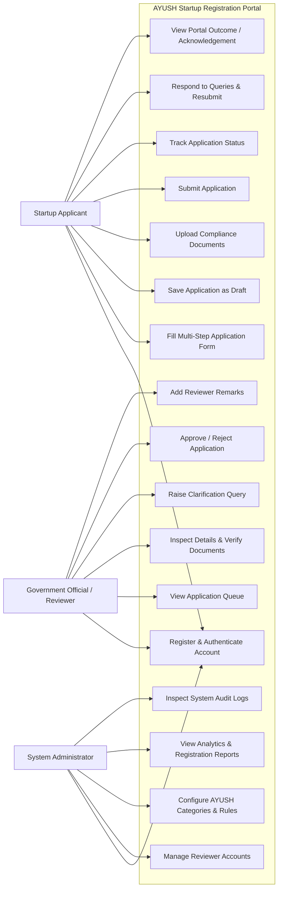

# User Roles, Permissions, and Use Case Analysis

This document describes target roles and permissions and notes the live API behavior. Real login, registration, logout, and session restoration are connected to `AuthContext`; live applicant profile/application flows use the backend. Startups can view and respond to clarification queries and resubmit applications. Officers can load assigned applications, start review, decide applications, and raise or resolve queries. Admins can load the non-draft queue, assign officers, and use review actions. Demo-role sign-in and demo workflows remain local. Document upload/verification and notification screens/APIs remain incomplete. See [implementation-status.md](./implementation-status.md).

## 1. Overview of Stakeholders

The **AYUSH Startup Registration Portal** serves three primary user personas, each with distinct business needs, responsibilities, and operational access levels:

1. **Startup Applicant**: Entrepreneurs, founders, and authorized company representatives seeking official recognition and benefits under Ministry of AYUSH schemes.
2. **Government Official / Reviewer**: Ministry officers and evaluation committee members responsible for scrutinizing applications, validating credentials, verifying laboratory/compliance documents, and adjudicating outcomes.
3. **Administrator**: System administrators managing user accounts, monitoring system health, maintaining audit trails, and accessing aggregate analytics.

---

## 2. Detailed Role Specifications

### 2.1 Startup Applicant

#### Role Description
The primary external consumer of the portal. The applicant is responsible for registering the venture, providing corporate and scientific data, uploading compliance documents, addressing queries raised by officials, and tracking the application to a portal-recorded outcome.

#### Key Functionalities & Permissions:
- **Account Management**: Register a personal/organizational account, authenticate via email/password, manage contact profile, and reset password.
- **Application Filing**: Create, edit, save as draft, and submit startup registration applications.
- **AYUSH Domain Categorization**: Specify primary and secondary AYUSH streams (Ayurveda, Yoga & Naturopathy, Unani, Siddha, Homoeopathy).
- **Document Management**: Upload, preview, update, and replace mandatory compliance files (incorporation certificate, licenses, test reports, pitch deck).
- **Query Resolution**: View comments and queries raised by reviewers, draft explanatory notes, and upload supplementary documents to resubmit.
- **Tracking & Outcome**: Monitor application status progression and view the final portal review outcome. Any portal acknowledgement is an internal administrative record, not a statutory AYUSH license or regulatory approval.

#### Operational Restrictions:
- Cannot access or review applications submitted by other startups.
- Cannot modify an application while it is under active review (status is `Submitted`, `Under Review`, `Approved`, or `Rejected`), except when in `Query Raised` state.
- Cannot approve, reject, or assign reviewers to any application.

---

### 2.2 Government Official / Reviewer

#### Role Description
The internal domain expert responsible for compliance verification. The reviewer accesses applications assigned to their account, conducts due diligence on claims, reviews available application details, and records portal workflow decisions.

#### Key Functionalities & Permissions:
- **Review Queue Management**: Access applications assigned to the reviewer; filter the connected queue by AYUSH discipline or status.
- **Application Evaluation**: Inspect full application details, including company profile, innovation description, and founder credentials.
- **Document Scrutiny**: Review document metadata in the current screen. File viewing and verification are not connected yet.
- **Query Raising**: Raise structured clarification requests citing missing paperwork, unverified claims, or license discrepancies.
- **Adjudication**: Start review for submitted or resubmitted applications, then approve or reject an under-review application. Rejection requires a reason.
- **Decision Audit Trail**: Review start and decision transitions create status-history and audit records. Decision time and remarks are derived from status history; no separate review timestamp or application remarks field is stored.

#### Operational Restrictions:
- Cannot create or submit startup registration applications.
- Cannot modify the applicant's entered business data directly (can only request the applicant to update via queries).
- Cannot modify global administrative configurations or manage other reviewer accounts.

---

### 2.3 Administrator

#### Role Description
The system custodian responsible for platform stability, role provisioning, security compliance, and high-level reporting to Ministry leadership.

#### Key Functionalities & Permissions:
- **User & Role Administration**: Create, activate, deactivate, or reassign reviewer and administrative accounts; manage user states.
- **Master Data Configuration**: Maintain system lists (e.g., supported AYUSH streams, document checklists, allowable file sizes, guidelines).
- **System-wide Visibility**: View all non-draft applications and review decisions across departments.
- **Officer Assignment**: Assign or reassign an officer to a submitted or in-progress application.
- **Review Screen Access**: The current API also authorizes administrators to start review and record approve/reject decisions.
- **Analytics & Reporting**: View high-level analytical dashboards detailing registration trends, regional distributions, average processing duration, and approval/rejection ratios.
- **Audit & Compliance Oversight**: Inspect system audit logs, track security events, and verify protocol compliance.

#### Operational Restrictions:
- In the target operating model, routine domain review belongs to the reviewer role. Current review endpoints also authorize administrators to run review transitions.
- Cannot tamper with or overwrite immutable audit records.

---

## 3. Role-Based Access Control (RBAC) Matrix

The following matrix details the permissions granted to each role across key system entities:

| Entity / Resource | Action | Startup Applicant | Government Reviewer | Administrator |
| :--- | :--- | :---: | :---: | :---: |
| **User Account** | Register / Login | Allowed (Self) | Allowed (Self) | Allowed (Self) |
| | Manage Reviewer Accounts | Denied | Denied | Allowed |
| | Deactivate Users | Denied | Denied | Allowed |
| **Application** | Create New Application | Allowed | Denied | Denied |
| | Edit Draft Application | Allowed (Own) | Denied | Denied |
| | View Application Details | Allowed (Own) | Allowed (Assigned) | Allowed (All non-draft) |
| | Edit when Query Raised | Allowed (Own) | Denied | Denied |
| | Assign Reviewer | Denied | Denied | Allowed (submitted/in-progress) |
| | Change Status to Under Review | Denied | Allowed (Assigned) | Allowed |
| | Change Status to Approved/Rejected | Denied | Allowed (Assigned, under review) | Allowed (under review) |
| **Documents** | Upload Documents | Allowed (Own) | Denied | Denied |
| | View/Download Documents | Allowed (Own) | Allowed (All/Assigned) | Allowed (All) |
| | Replace/Upload Additional Docs | Allowed (Query State) | Denied | Denied |
| **Queries** | Raise Review Query | Denied | Allowed | Denied |
| | View Raised Query | Allowed (Own) | Allowed (All/Assigned) | Allowed (All) |
| | Respond to Query | Allowed (Own) | Denied | Denied |
| **Portal Acknowledgement** | Generate internal acknowledgement (if included in scope) | Automated | Automated | Automated / View |
| | View/download acknowledgement | Allowed (Own) | Allowed | Allowed |
| **Audit Logs & Metrics** | View Audit Trail | Allowed (Status Timeline) | Allowed (Application) | Allowed (Full System) |
| | View Analytical Dashboards | Denied | Denied (Limited Queue) | Allowed (Complete) |

---

## 4. Use Case Diagram

The use case diagram below depicts the system boundaries, the three primary actors, and their interactions with the portal's core capabilities.

---

## 5. Security & Separation of Concerns

1. **Principle of Least Privilege**: Users are granted only the permissions essential to perform their required tasks.
2. **Separation of Evaluation and Administration**: System Administrators cannot approve applications, ensuring that regulatory decisions are made exclusively by certified government officials.
3. **Data Isolation between Startups**: Startup accounts are strictly scoped to their own records via tenant/user boundary checks on every database query.

